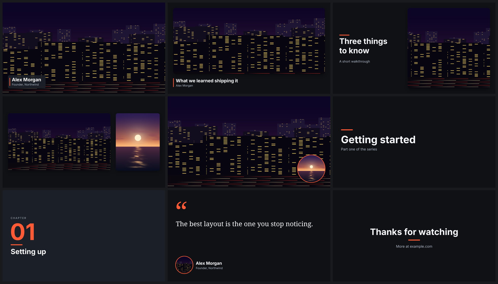
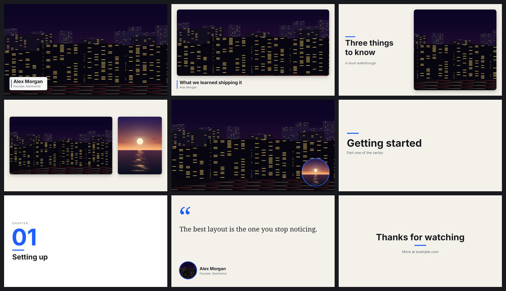
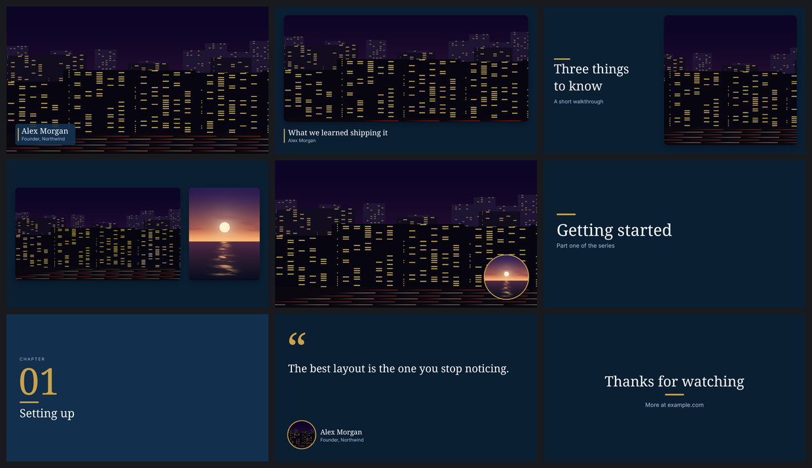
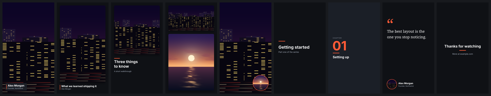
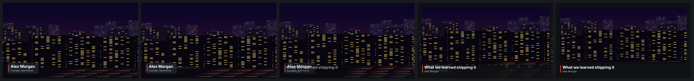
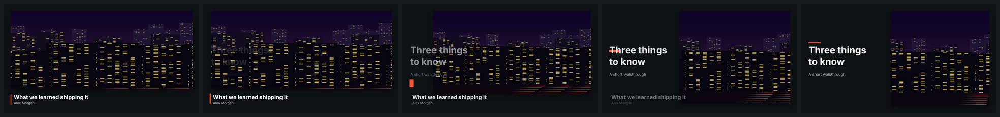
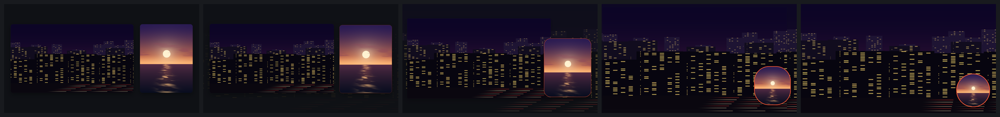
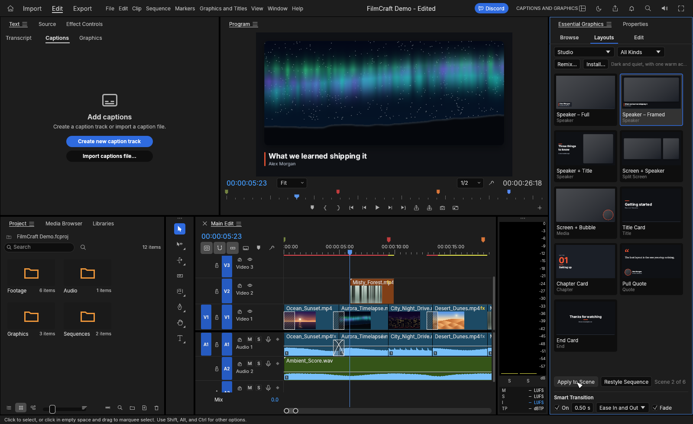

# FilmCraft Layout Packs

Open layout packs for [FilmCraft](https://github.com/storytold/filmcraft), the open-source video
editor.

A **layout** frames the footage of a scene: the speaker in a rounded window on a background, a
screen recording beside the speaker, a name plate over the picture, a title or chapter card. A
**layout pack** is a set of layouts that share one look, so a whole video keeps one style and can
be restyled in one step. When one layout follows another, a **smart transition** carries what
they share from its old place to its new one.

Nothing is baked into your footage. A layout is a clip on its own track above the footage; its
windows show the tracks under it. You keep trimming, cutting and colour correcting the footage as
before, and the layout follows.



## What is here

| Folder | Contents |
|---|---|
| [`packs/`](packs) | The packs, as `.fcpack` files (plain JSON) |
| [`previews/`](previews) | Pictures of every layout, and of the smart transitions |
| [`docs/layout-packs.md`](docs/layout-packs.md) | How layouts, packs and smart transitions work, every command, and the `.fcpack` format |

### The packs

| Pack | Look |
|---|---|
| [Studio](packs/studio.fcpack) | Dark and quiet, one warm accent |
| [Paper](packs/paper.fcpack) | Light and editorial: warm paper, dark type, a blue accent |
| [Harbor](packs/harbor.fcpack) | Navy and brass with a serif heading |

Each has nine layouts, drawn for 16:9, 9:16, 1:1 and 4:5 frames: Speaker – Full, Speaker –
Framed, Speaker + Title, Screen + Speaker, Screen + Bubble, Title Card, Chapter Card, Pull Quote
and End Card.

| Paper | Harbor |
|---|---|
|  |  |

The same layouts on a vertical frame:



### Smart transitions

Layers that are the same thing in two layouts (the speaker's window, the background, the accent
bar) move and resize into place; the rest fade. Five frames across half a second:





### In the app

Essential Graphics has a Layouts tab: pick a pack, pick a layout, Apply to Scene.



## Using them

These packs need a FilmCraft build with layout packs. Until that is part of FilmCraft itself, it
lives on the `layout-packs` branch of
[robertmonroe/filmcraft](https://github.com/robertmonroe/filmcraft/tree/layout-packs):

```sh
git clone -b layout-packs https://github.com/robertmonroe/filmcraft
cd filmcraft
cargo run --release -p filmcraft
```

The three packs above are built into that build, so there is nothing to install to try them.
To add a pack file (yours, or one someone shared): Essential Graphics ▸ Layouts ▸ **Install…**,
or

```sh
filmcraft-cli exec layout.pack.install path=packs/studio.fcpack
```

Then, in the app: open Essential Graphics ▸ **Layouts**, put the playhead in a scene, select a
layout and press **Apply to Scene**. Or from a terminal, or from an AI agent over MCP:

```sh
filmcraft-cli --project talk.fcproj exec layout.scenes
filmcraft-cli --project talk.fcproj --save exec layout.apply '{"pack":"Studio","layout":"speaker-framed","scene":0,"values":{"heading":"What to ask on a tour"}}'
```

## Making your own

- **Remix a pack.** Essential Graphics ▸ Layouts ▸ **Remix…** opens the pack's colours and fonts;
  saving gives you the same nine layouts in your brand, as a pack of your own.
- **Save your own layouts.** Build a graphic with text, shapes and media windows, then Graphics
  and Titles ▸ Layouts ▸ **Save As Layout…** adds it to your pack.
- **Edit the file.** A `.fcpack` is JSON. Open one from [`packs/`](packs), change it, install it.
  The format is in [docs/layout-packs.md](docs/layout-packs.md#the-fcpack-format).

Your packs are in the *Layout Packs* folder of FilmCraft's data directory. To share one, send
the file, or open a pull request adding it to [`packs/`](packs).

## Contributing a pack

Pull requests are welcome. A pack in this repository must be:

- **Your own design.** Do not copy the layouts, templates or assets of another application or
  another person's video.
- **Free to share.** State an open licence in the pack's `license` field. Only embed fonts whose
  licence allows redistribution (the packs here use Inter and Noto Serif, both SIL OFL 1.1, which
  FilmCraft bundles, so they embed none).
- **Complete.** Give layers that should travel between layouts the same name in each (see
  *Smart transitions* in the docs), and include a design for 16:9 at least.

## Licence

The packs, pictures and text in this repository are dual-licensed under
[MIT](LICENSE-MIT) or [Apache-2.0](LICENSE-APACHE), at your option, the same terms as FilmCraft.
A contributed pack keeps the licence its `license` field states.
